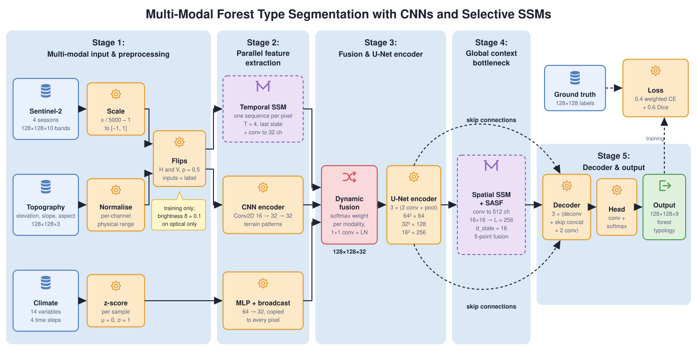

# Multi-Modal Forest Type Segmentation (CNN-Mamba)

**Project lead: Yike Chen.**

Course project at the Chinese University of Hong Kong, Shenzhen, with
Qianhua Wan, Cherng Khai Hng and Jiawei Li.

This project combines convolutional encoders with a **Mamba-inspired selective
state-space model** to map forest types from Sentinel-2 seasonal imagery,
climate variables and terrain. It includes a TensorFlow segmentation model,
training and evaluation tools, and a predictor for prepared satellite tiles.

[Project brief](docs/project-summary.md) · [Usage](docs/user.md) ·
[Design](docs/design.md) · [Results and evidence](results/README.md)

## Problem

Natural forest, planted forest and tree crops can have similar canopy cover,
yet represent different land uses. ForTy v1 [[1]](#ref-1) frames this distinction
as pixel-level classification across nine land-cover classes. The model uses
four seasonal optical composites together with climate and terrain to represent
both seasonal patterns and spatial context.

The implemented task is **forest type segmentation**. Comparing maps across
years is a potential extension requiring independent temporal validation.

## Model



1. **Encode each modality.** A temporal selective-SSM block summarizes the
   four-season optical sequence at each pixel; a convolutional encoder handles
   terrain, and an MLP embeds climate variables.
2. **Fuse the inputs.** A learned, sample-dependent weighting combines the
   three modality embeddings before a U-Net-style encoder [[3]](#ref-3).
3. **Aggregate spatial context.** A second selective-SSM block scans the
   16 × 16 bottleneck in raster order. Structure-Aware State Fusion
   [[10]](#ref-10) mixes local neighbours after the scan.
4. **Recover the segmentation map.** A decoder with skip connections produces
   nine-class pixel probabilities. Training combines weighted cross-entropy
   and soft Dice loss to address class imbalance.

CNN-Mamba is the project name for a custom TensorFlow adaptation inspired by
Mamba [[2]](#ref-2). Its shared low-rank state projection and `tf.scan`
recurrence are described in the [design document](docs/design.md#selective-state-space-blocks).
The sequential recurrence has device-dependent overhead; its complexity alone
does not establish an efficiency advantage over attention.

## What the repository implements

- **Training and evaluation:** seeded shard selection, per-epoch split
  manifests, validation-selected checkpoints, confusion-derived F1 metrics and
  saved model configuration.
- **Experiment integrity:** paired objective plans and artifact checks bind
  comparisons to exact data paths, training budgets and checkpoint hashes.
- **Tile prediction:** shared preprocessing, automatic checkpoint architecture
  restoration, optional colour maps and a CSV of predicted class shares.
- **Local development:** local TFRecord support, CPU float32 selection,
  synthetic integration checks, a one-command demo and performance benchmarks.

These are implementation and software-validation capabilities. The next
research question is whether the selective-SSM modules improve segmentation
over a matched CNN control; that experiment has not been run here.

## Results

The repository retains several kinds of evidence with different scopes:

| Evidence | Retained result | Scope |
|---|---|---|
| Historical ForTy scores | Overall macro F1 **56.89%**; forest mean F1 **48.81%** | Historical report; source logs and trained checkpoint are not retained |
| Synthetic CPU workflow | Both objectives completed two epochs; all seven workflow stages passed | Checks training, checkpoint reload, evaluation and artifact comparison on local synthetic records |
| File-to-file CPU prediction | **60 measured tiles**, about **7.20 tiles/s** including PNG and CSV output | Reduced demo model, synthetic 128 × 128 inputs; 30 passes after one warmup pass |
| Default-model CPU compute | Eager median **316.54 ms**; graph median **149.01 ms** | Synthetic 128 × 128 inference, batch 1; three samples per mode after two warmups |
| Automated checks | **225 tests passed** in the last retained check record | CPU software checks; not a real-data accuracy study |

The historical scores used a rotating 128-shard training budget and a 64-shard
test subset. Published UNet3D, UTAE and MTSViT scores use different training and
evaluation protocols, so they provide context rather than a controlled ranking.
Historical scores cannot be independently reproduced from the retained files.
The CPU timings exclude dataset IO, preprocessing, checkpoint loading and
output-file writes. No new real ForTy training, full-test evaluation or GPU
performance measurement has been completed in the current environment.

[Results](results/README.md) contains the historical table and experiment
protocol. Raw [CPU timings](results/performance_cpu_128.json),
[workflow checks](results/paired_pipeline_smoke.json) and the
[optimization audit](docs/optimization-audit.md) document the retained evidence.
The [local demo record](results/local_demo_cpu.json) and
[file-to-file timings](results/performance_predict_cpu.json) cover the new
offline demonstration and prediction benchmark. Its reduced architecture and
timing boundary differ from the default-model compute diagnostic above.

## Dataset

[ForTy v1](https://github.com/google-deepmind/forest_typology/tree/main/forty_v1)
[[1]](#ref-1) contains about 200,000 globally sampled 128 × 128 tiles. Each
split is published as 1,024 TFRecord shards.

| Input | Per-tile shape | Role |
|---|---|---|
| Sentinel-2 | `(4, 128, 128, 10)` | Four seasonal optical composites |
| Terrain | `(128, 128, 3)` | Elevation, slope and aspect |
| Climate | `(4, 14)` after parsing | Seasonal climate variables |
| Labels | `(128, 128)` | Nine classes, including the three forest types |

The benchmark describes geographically blocked train/validation/test splits
in an 8:1:1 ratio. This package preserves the published split namespaces; the
model inputs do not retain coordinates or block IDs, so geographic separation
has not been independently verified here.

### Training, Validation and Test Sets

| Split | Default shard budget | Use |
|---|---|---|
| Training | 128 of 1,024, resampled each epoch | Fit model weights |
| Validation | 8 of 1,024, fixed | Select the checkpoint |
| Test | 64 of 1,024 | Evaluate the selected checkpoint |

The 12.5% training share is a **per-epoch read budget**, not total unique data
usage. New runs save exact paths in `split_manifest.json`;
`--fixed-train-subset` keeps training membership fixed. Validation and test
use the first N shards by default, which may be unrepresentative if shard
order correlates with geography. Full-split evaluation uses
`--test-shards 1024`.

## Setup

Use Python **3.10–3.12**; the retained checks used Python 3.12 and TensorFlow
2.21. A stable TensorFlow release may not be available for a newer interpreter.
The dependencies and editable package installation are handled by `make install`.

```bash
python3.12 -m venv .venv
source .venv/bin/activate
make install
make test
make lint
```

The tests use CPU computation, synthetic tensors and temporary local TFRecords;
they require neither a GPU nor access to the ForTy bucket. A pinned CPU
installation recipe is also available in the
[environment guide](docs/cloud-environment.md#install-into-a-new-virtual-environment).

## Local demonstration

After installation, run the complete workflow on generated synthetic data:

```bash
make demo
```

The demo uses CPU computation and the standard 128 × 128 input format. It
generates local TFRecords, trains a small model for two epochs, evaluates the
saved checkpoint and predicts the test tiles. A fresh run directory contains
class maps, a CSV, prediction timings and a labelled synthetic comparison
figure. The scores demonstrate software behavior on toy data.

The [local demo guide](docs/local-demo.md) explains output files and a separate
end-to-end benchmark covering tile reads, preprocessing, inference and export.

## Training

Default-scale training assumes a suitable GPU and authorized read access to
the ForTy bucket. Configure application-default credentials on that host, for
example with `gcloud auth application-default login`. The repository ships
code and diagnostics; trained model weights must be produced separately.

```bash
make train
make eval
```

These commands write to `runs/mamba_forest` by default. Training selects
`best.weights.h5` using validation F1; evaluation reads the test split.
The [usage guide](docs/user.md) lists all flags and outputs, including
`--data-root` and `--total-shards` for
[local-data workflows](docs/user.md#local-data-and-offline-checks).

## Mapping Your Own Region

Prepare `.npz` tiles containing the optical, terrain and climate arrays, and
keep the trained checkpoint together with its `config.json`.

```bash
make predict TILES=my_tiles OUT=predictions
```

Prediction writes class maps, optional PNGs and a CSV of class shares.
[The application guide](docs/apply.md) specifies array shapes, units, band
order and output interpretation. Reliable mapping of a new region requires
validation on representative labelled imagery from that region.

## Documentation

| Read about | Guide |
|---|---|
| Project context, team and evidence | [Technical brief](docs/project-summary.md) |
| A complete local example and prediction timings | [Synthetic demo and end-to-end benchmark](docs/local-demo.md) |
| Running the software | [Usage](docs/user.md) · [Tile prediction](docs/apply.md) |
| Architecture and preprocessing | [Design](docs/design.md) |
| Code layout and APIs | [Developer overview](docs/developer.md) · [Reference](docs/reference.md) |
| Extending and checking the code | [Common tasks](docs/tasks.md) · [Testing](docs/testing.md) · [Style](docs/coding.md) |
| Experiments and retained evidence | [Results](results/README.md) · [Optimization audit](docs/optimization-audit.md) |
| Preparing a later real-data run | [Validation runbook](docs/gpu-validation.md) · [Environment setup](docs/cloud-environment.md) · [Colab recipe](docs/colab-free.md) |

## References

1. <a id="ref-1"></a>Y. Jiang and M. Neumann. Not every tree is a forest:
   Benchmarking forest types from satellite remote sensing. 2025.
   [arXiv:2505.01805](https://arxiv.org/abs/2505.01805)
2. <a id="ref-2"></a>A. Gu and T. Dao. Mamba: Linear-time sequence modeling
   with selective state spaces. 2023.
   [arXiv:2312.00752](https://arxiv.org/abs/2312.00752)
3. <a id="ref-3"></a>O. Ronneberger, P. Fischer and T. Brox. U-Net:
   Convolutional networks for biomedical image segmentation. *MICCAI*, 2015.
   [arXiv:1505.04597](https://arxiv.org/abs/1505.04597)
4. <a id="ref-4"></a>Ö. Çiçek, A. Abdulkadir, S. S. Lienkamp, T. Brox and
   O. Ronneberger. 3D U-Net: Learning dense volumetric segmentation from sparse
   annotation. *MICCAI*, 2016. [arXiv:1606.06650](https://arxiv.org/abs/1606.06650)
5. <a id="ref-5"></a>V. Sainte Fare Garnot and L. Landrieu. Panoptic
   segmentation of satellite image time series with convolutional temporal
   attention networks. *ICCV*, 2021.
   [arXiv:2107.07933](https://arxiv.org/abs/2107.07933)
6. <a id="ref-6"></a>M. Drusch et al. Sentinel-2: ESA's optical high-resolution
   mission for GMES operational services. *Remote Sensing of Environment* 120,
   2012. [doi:10.1016/j.rse.2011.11.026](https://doi.org/10.1016/j.rse.2011.11.026)
7. <a id="ref-7"></a>J. T. Abatzoglou, S. Z. Dobrowski, S. A. Parks and
   K. C. Hegewisch. TerraClimate, a high-resolution global dataset of monthly
   climate and climatic water balance from 1958–2015. *Scientific Data* 5,
   2018. [doi:10.1038/sdata.2017.191](https://doi.org/10.1038/sdata.2017.191)
8. <a id="ref-8"></a>L. Hawker, P. Uhe, L. Paulo, J. Sosa, J. Savage, C. Sampson
   and J. Neal. A 30 m global map of elevation with forests and buildings
   removed. *Environmental Research Letters* 17, 2022.
   [doi:10.1088/1748-9326/ac4d4f](https://doi.org/10.1088/1748-9326/ac4d4f)
9. <a id="ref-9"></a>Z. Wang, J.-Q. Zheng, Y. Zhang, G. Cui and L. Li.
   Mamba-UNet: UNet-like pure visual Mamba for medical image segmentation.
   2024. [arXiv:2402.05079](https://arxiv.org/abs/2402.05079)
10. <a id="ref-10"></a>C. Xiao, M. Li, Z. Zhang, D. Meng and L. Zhang.
    Spatial-Mamba: Effective visual state space models via structure-aware
    state fusion. *ICLR*, 2025. [arXiv:2410.15091](https://arxiv.org/abs/2410.15091)
11. <a id="ref-11"></a>C. Szegedy, V. Vanhoucke, S. Ioffe, J. Shlens and
    Z. Wojna. Rethinking the Inception architecture for computer vision.
    *CVPR*, 2016. [arXiv:1512.00567](https://arxiv.org/abs/1512.00567)
12. <a id="ref-12"></a>F. Milletari, N. Navab and S.-A. Ahmadi. V-Net: Fully
    convolutional neural networks for volumetric medical image segmentation.
    *3DV*, 2016. [arXiv:1606.04797](https://arxiv.org/abs/1606.04797)
13. <a id="ref-13"></a>I. Loshchilov and F. Hutter. Decoupled weight decay
    regularization. *ICLR*, 2019. [arXiv:1711.05101](https://arxiv.org/abs/1711.05101)
14. <a id="ref-14"></a>I. Loshchilov and F. Hutter. SGDR: Stochastic gradient
    descent with warm restarts. *ICLR*, 2017.
    [arXiv:1608.03983](https://arxiv.org/abs/1608.03983)
15. <a id="ref-15"></a>P. Micikevicius et al. Mixed precision training. *ICLR*,
    2018. [arXiv:1710.03740](https://arxiv.org/abs/1710.03740)

## Acknowledgments

The ForTy v1 benchmark and the baseline results are from Jiang and Neumann
[[1]](#ref-1), Google DeepMind.

## License

MIT — see [LICENSE](LICENSE).
