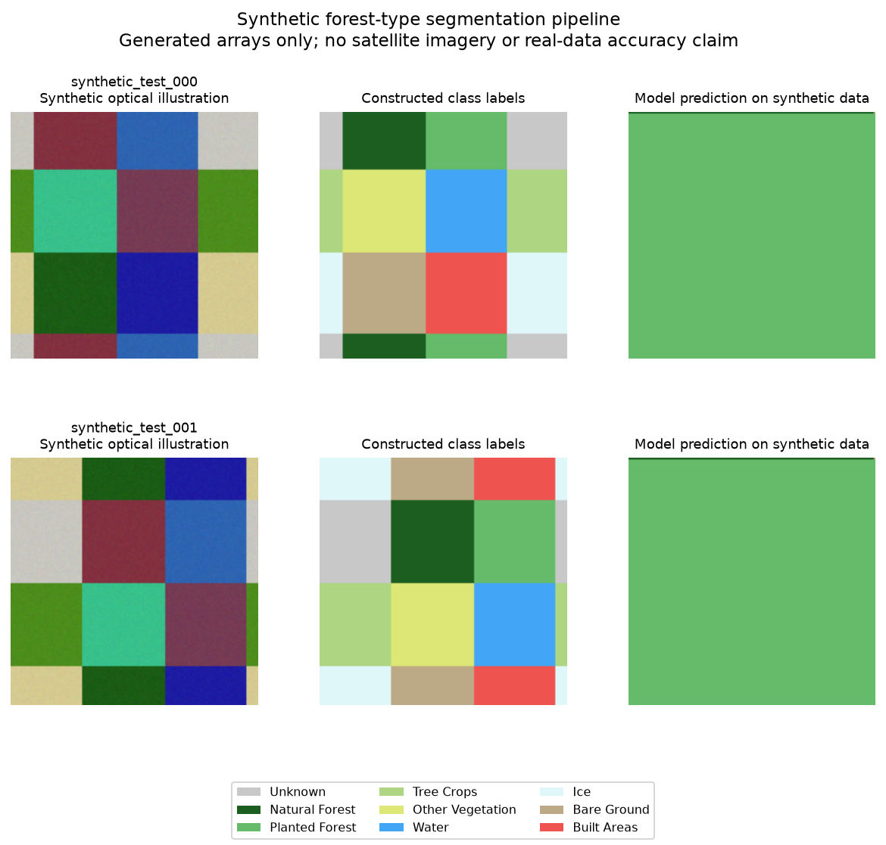

[Documentation](README.md) · [Project overview](../README.md)

# Local synthetic demo and prediction timing

The local demo runs the installed training, evaluation and prediction commands
on generated data. It needs CPU computation and the existing project
dependencies; no dataset download, cloud credentials or GPU is required.

**On this page**

- [Run the demonstration](#run-the-demonstration)
- [Inspect the outputs](#inspect-the-outputs)
- [Time a normal prediction run](#time-a-normal-prediction-run)
- [Repeat the end-to-end benchmark](#repeat-the-end-to-end-benchmark)
- [View the retained example](#retained-example)

## Run the demonstration

From the repository root, after following [Setup](../README.md#setup):

```bash
make demo
```

Each invocation creates a unique directory under `runs/`. To choose a path:

```bash
make demo DEMO_ARGS="--output-dir runs/local-demo"
```

An explicitly selected output directory must be new or empty. Existing
nonempty directories are rejected. Choose another output path for a new run.

Defaults use seed 42, four training examples, two validation examples and two
test examples, with one TFRecord shard per split. The records use the actual
128 × 128 ForTy parser schema. The small model uses `d_model=4`, temporal and
spatial state dimensions of 2, a bottleneck width of 8 and zero dropout. It
trains for two epochs with batch size 2 and CPU float32 computation.

Generated optical channels, terrain, climate and class masks are synthetic.
The example shows a functioning workflow and reproducible artifacts; its
images and scores do not establish performance on satellite imagery.

## Inspect the outputs

| Path inside the run directory | Contents |
|---|---|
| `data/` | Local train/validation/test TFRecords and a fixture manifest |
| `tiles/` | Unnormalized test inputs in the prediction tool's NPZ format |
| `training/` | Configuration, checkpoints, epoch metrics and split manifests |
| `evaluation/test_metrics.json` | Metrics and checkpoint identity on synthetic test records |
| `predictions/` | Predicted maps, PNGs, class-share CSV and `timings.json` |
| `comparison.png` | Toy optical channels, synthetic labels and model predictions, explicitly labelled |
| `logs/` | Output of the training, evaluation and prediction commands |
| `summary.json` | Run status, scope, source information and artifact locations |

The run summary and available stage logs remain available if a command fails.
Use a fresh output directory after resolving the error. The demo does not
resume training or silently replace a previous run.

## Time a normal prediction run

The prediction CLI can save a timing report beside its normal outputs:

```bash
python -m mamba_forest.predict \
    --weights runs/local-demo/training/best.weights.h5 \
    --input-dir runs/local-demo/tiles \
    --output-dir runs/local-demo-timed-predictions \
    --save-png \
    --timings runs/local-demo-timed-predictions/timings.json
```

The report records input reads and validation, normalization, model setup and
checkpoint loading, inference and returned tensors, postprocessing, file
export and CSV writing. It distinguishes the first inference, which includes
graph tracing, from later predictions. Input dimensions, checkpoint identity,
output options and runtime metadata make the measurement interpretable.

## Repeat the end-to-end benchmark

To benchmark the checkpoint and inputs from the explicitly named demo above:

```bash
make benchmark-predict \
    WEIGHTS=runs/local-demo/training/best.weights.h5 \
    TILES=runs/local-demo/tiles \
    BENCHMARK_OUT=runs/local-demo-benchmark
```

This calls the same prediction path with one warmup pass followed by 30
measured passes. Each pass reads every input tile and writes its own outputs;
two inputs produce 60 measured tile samples. Warmup samples are recorded
separately and excluded from steady-state summaries. Use a new benchmark
output directory for each invocation.

`benchmark.json` contains the summary, raw samples and runtime metadata;
`prediction_timings.json` retains the production predictor's full report.
`warmup_000/` and `measured_000/` through `measured_029/` hold the corresponding
maps and CSVs. A reservation file marks the directory as used so concurrent
or repeated runs cannot silently mix their outputs.

Per-tile `pipeline_seconds` sums read/validation, preprocessing, synchronized
inference, postprocessing and array/PNG writes. CSV writes are recorded
separately. Complete-pass wall times and overall wall times also include
directory creation, CSV close/flush and other bookkeeping. Model setup and
the first graph trace are shown separately from steady-state stage summaries.

The CLI exposes the same operation directly and can include probability
arrays in addition to PNG and class-map output:

```bash
python -m mamba_forest.benchmark_predict \
    --weights runs/local-demo/training/best.weights.h5 \
    --input-dir runs/local-demo/tiles \
    --output-dir runs/local-demo-benchmark-with-probabilities \
    --warmup 1 --repeats 30 --save-png --save-probabilities
```

Warmup and repeat counts refer to full input passes. The benchmark reuses one
loaded model; repeated reads may benefit from the operating system's file
cache. File-export timing covers writes and closes to the filesystem cache,
without requesting physical-disk synchronization. Process startup is outside
the timing boundary, and the benchmark records its runtime import cost
separately. These measurements differ from the in-memory compute benchmark
in [the usage guide](user.md#measuring-compute-performance).

The demo checkpoint has a reduced architecture. Measurements from it should
be compared only with runs using the same architecture, inputs, precision,
thread settings and output options. A trained checkpoint from another run
can be substituted without changing the timing workflow. Neither benchmark
establishes segmentation accuracy or GPU performance.

## Retained example

The [demo record](../results/local_demo_cpu.json) retains the completed
two-epoch 4/2/2-example run and checkpoint identity. The
[prediction benchmark](../results/performance_predict_cpu.json) retains 60
measured tile samples after one complete warmup pass, using that same reduced
checkpoint and synthetic test tiles. The recorded throughput, including PNG
and CSV output, was about 7.20 tiles per second on the measured CPU runtime.

The figure below shows generated optical illustrations, constructed labels
and actual model predictions from the two-epoch workflow check. This short
training budget can produce nearly uniform predictions; the figure displays
the pipeline output rather than a model-quality benchmark.


