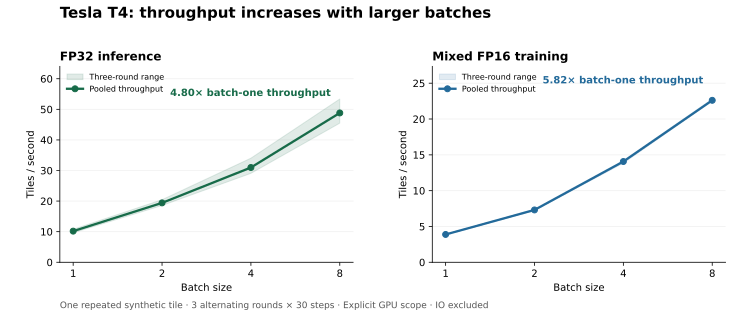

[Documentation](README.md) · [Project overview](../README.md)

# Runtime performance

Measure model compute, validation overhead and file-to-file prediction with
explicit timing boundaries. Class-ID semantics are tracked in the
[publisher question](https://github.com/google-deepmind/forest_typology/issues/2);
the synthetic compute checks here do not depend on semantic class names.

## What changed

- **Temporal readout:** the model requests only the final output of the temporal
  selective SSM. Earlier C/readout/gate/output projections are omitted. The
  recurrence still consumes every season; known lengths up to eight use the
  same float32 updates in an unrolled graph. Dynamic/long sequences and the
  spatial block retain `tf.scan`.
- **Validation:** training retains one `DatasetEvaluator` and resets its
  confusion matrix for each epoch. Its graph reads current model weights and
  remains outside checkpoint state. The public one-shot `evaluate()` API is
  preserved.
- **Measurement:** requested devices are checked, GPU fallback is rejected,
  measured training steps must advance the optimizer, and source/checkpoint
  identity is recorded. Prediction preprocessing has an explicit host barrier;
  its checkpoint hash is checked around loading.

Model configuration, parameter shapes and checkpoint structure are unchanged.
Deterministic forward/gradient tests cover the final-only path and its dynamic
fallback, and old checkpoints still load. Training dropout samples a smaller
output mask: its distribution is unchanged, but seeded training trajectories
need not match sample for sample. No new accuracy claim follows from this work.

## Retained CPU comparison

The [raw CPU record](../results/performance_cpu_20261026/README.md) uses the full
7,732,800-parameter model, 128 × 128 inputs, batch one, float32, TensorFlow
2.21.0 and two intra/inter-op threads on an AMD EPYC 9V74 host with a four-CPU
container quota. Baseline `82723f3` and core candidate `6289f22` share one
synthetic input fixture and one initial checkpoint. Three rounds alternate
source order; every source/workload/round runs in a fresh process with five
warmups and 30 measured steps. All saved forward comparisons had maximum
absolute error 0.0 and identical argmax outputs on this fixture.

| Measurement | Baseline | Candidate | Observed result |
|---|---:|---:|---|
| Inference median, round 1 | 140.26 ms | 129.27 ms | 7.83% lower latency |
| Inference median, round 2 | 160.83 ms | 146.58 ms | 8.86% lower latency |
| Inference median, round 3 | 128.61 ms | 120.36 ms | 6.41% lower latency |
| Training pooled median, 90 steps per revision | 470.75 ms | 471.39 ms | No stable speedup |

The median paired-round inference reduction is **7.83%**. Pooling all 90
inference samples gives 146.07 → 129.27 ms, or 11.50%; this differs from the
paired summary because pooling summarizes a different distribution. Training
rounds varied in direction, so they do not establish a training-step gain.
These descriptive observations are specific to this environment.

A separate [validation reuse record](../results/performance_cpu_20261026/validation-reuse.json)
uses the same optimized model in both cases, with 20 repeated in-memory
synthetic batches per pass. Three measured passes changed median wall time
from **3.770 s to 3.147 s** (16.5% reduction), with identical confusion matrices
and one retained graph trace. This includes iteration, tracing and metrics;
it does not include remote data IO or compare two different model versions.

The [production-path check](../results/performance_cpu_20261026/production/protocol.json)
uses a different, reduced 3,311,968-parameter checkpoint and two synthetic NPZ
tiles, with NPY/PNG/CSV exports enabled. Three alternating rounds each export
30 measured passes after one warmup pass: 180 tile executions per revision.
Pooled measured-pass throughput was **7.05 vs 7.03 tiles/s**; round directions
varied, so no stable file-to-file speedup was established. All 180 paired
measured class maps were identical. Reads are warm-cache and no fsync boundary
is claimed. The compute-only improvement above must not be applied to this
different model and timing boundary.

## Retained Tesla T4 comparison

The [raw T4 record](../results/performance_t4_20261026/README.md) uses the same
full model and 128 × 128, batch-one protocol, with three alternating rounds,
five warmups and 30 measured steps per process. Baseline `82723f3` and
candidate `f49b004` share one synthetic input fixture and initial checkpoint.
All 13 stages passed on TensorFlow 2.21.0 / Keras 3.13.2, with float32
inference and mixed-float16 training. Every measured training step updated
the optimizer.

| Measurement | Baseline | Candidate | Observed result |
|---|---:|---:|---|
| Inference pooled median, 90 steps | 94.197 ms | 94.834 ms | No stable speedup |
| Training pooled median, 90 steps | 251.490 ms | 257.948 ms | No stable speedup |
| Inference allocator peak, median of three rounds | 73.539 MiB | 64.164 MiB | 12.75% lower |
| Training allocator peak, median of three rounds | 251.887 MiB | 236.676 MiB | 6.04% lower |

Paired latency reductions varied in direction: −3.98% to +3.21% for inference
and −5.34% to +0.58% for training. Allocator peaks decreased in every round.
Memory here includes starting live TensorFlow allocations; it is not total
GPU VRAM. The measured gain on T4 is reduced allocator memory, with no
demonstrated latency gain at batch one.

Forward checks passed tolerance bounds, but argmax outputs were not exactly
identical. Float32 candidate maximum error was `1.0431e-7`, with one changed
pixel out of 16,384. Mixed-precision checks had maximum error `6.8158e-5`
and at most eight changed pixels; baseline mixed-precision checks also varied
across processes. These are pre-training checks on synthetic inputs and
initialized weights, not accuracy or convergence measurements. No GPU
file-to-file or validation-reuse speedup was measured. Profiling GPU execution
and testing larger batches are covered in the subsequent study below.

## Retained T4 batch scaling and profiles

The [batch-study record](../results/batch_study_t4_20261028/README.md) retains
24 timing processes and four separate real GPU captures at clean source
`fac8b8d`. It uses one initialized full-model checkpoint and one repeated
synthetic 128 × 128 tile, three alternating batch-order rounds, five warmups
and 30 samples per case. Inference is float32; training is mixed float16.



| Batch | Inference tiles/s | Training tiles/s | Inference batch median | Training batch median |
|---:|---:|---:|---:|---:|
| 1 | 10.18 | 3.89 | 94.34 ms | 255.11 ms |
| 2 | 19.42 | 7.31 | 99.93 ms | 270.00 ms |
| 4 | 30.98 | 14.07 | 129.68 ms | 279.87 ms |
| 8 | **48.82** | **22.61** | 163.26 ms | 350.43 ms |

Batch eight has 4.80× inference and 5.82× training throughput versus batch one,
with improvements in every round. Its median allocator peaks are 445.85 MiB
and 1121.29 MiB, respectively; no case ran out of memory. Whole-batch latency
increases. These results establish synthetic capacity under the recorded
protocol, not single-request latency, production IO speed or training quality.
Batch eight is the highest tested batch and is not proven optimal.

Each trace has actual GPU compute/copy events and 2,313 one-byte forward
spatial-scan condition transfers over three steps. The transfer GPU durations
are only 1.58–2.29 ms per capture; counts alone do not prove a latency cause.
The worker forces its entire scope onto the GPU, whereas production uses
automatic placement. Investigate that difference before changing recurrence
code. Recorded GPU-event time fractions include profiler effects and are not
utilization or occupancy. See the retained method, hashes and limitations.

The [profiling guide](gpu-profiling.md) reproduces the study and trace exports.
Prediction now accepts optional bounded batches; its real file-to-file GPU
throughput remains a separate measurement using `benchmark_predict`.

## Run the source comparison locally

After installing the project dependencies, create a detached baseline checkout:

```bash
git worktree add --detach ../geospatial-perf-baseline \
  82723f3183231a36e736c1c118a866aed5ad9d6b
```

Use a new output directory. The common harness generates the shared input and
checkpoint with the baseline, checks predictions before timing, and verifies
source paths, fixture dimensions, hashes and complete raw sample budgets:

```bash
TF_NUM_INTRAOP_THREADS=2 TF_NUM_INTEROP_THREADS=2 OMP_NUM_THREADS=2 \
python scripts/compare_performance.py \
  --baseline-root ../geospatial-perf-baseline --candidate-root . \
  --run-root runs/performance-comparison --device /CPU:0 \
  --training-precision float32 --rounds 3 --steps 30 --warmup 5
```

The initial weights are seeded synthetic initialization, not a trained model.
`--weights PATH` can supply an existing checkpoint matching the full default
architecture; both revisions then load that same checkpoint. Imports, tracing,
source IO, preprocessing, loading and output export are excluded from the
compute samples. Process wall times are retained separately. Integrity checks
remain active under optimized Python execution.

Measure validation-graph reuse separately with the generated fixture:

```bash
python scripts/measure_validation.py \
  --fixture-dir runs/performance-comparison/fixture \
  --output runs/performance-comparison/validation-reuse.json \
  --device /CPU:0 --batches 20 --steps 3
```

## Run the GPU comparison

[Open the performance notebook in Colab](https://colab.research.google.com/github/CCC917111/geospatial-mamba-deforestation/blob/main/notebooks/colab_performance.ipynb),
select an available GPU and run the cells in order. It pins baseline and
candidate source commits, uses the existing Colab TensorFlow stack, and runs
inference in float32 and training in mixed float16. No ForTy download is
required. The retained T4 run above completed this comparison; it establishes
lower allocator peaks without a stable inference or training latency gain.

Each measured training step must perform one optimizer update. Loss-scale
adaptation is permitted during warmup; a skipped measured update fails the
run rather than producing a faster but incomplete workload. Increase the
common warmup for both revisions if the diagnostic requires it.

The report records TensorFlow allocator live memory after warmup, resets the
peak counter, then captures measured peak and peak above starting live memory.
These values are not total/reserved GPU VRAM. The source comparison uses one
model and one workload per fresh process. The standalone compute CLI also
reports memory, but `--mode both` retains multiple models and its residency
caveat must be respected when comparing peaks.

Download the metadata ZIP and retain its raw reports. Checkpoints and input
arrays remain in the Colab runtime and are excluded from the small diagnostic
download. A failed run retains logs and execution status. Free GPU availability
and session duration vary; no runtime guarantee is assumed.

## Other timing boundaries

- `python -m mamba_forest.benchmark`: synthetic in-memory model compute;
  optional `--weights` requires explicit matching architecture flags.
- `python -m mamba_forest.benchmark_predict`: the production file-to-file
  prediction path, including input validation, normalization, tensor copies,
  postprocessing and requested exports. See the [timing guide](local-demo.md).

Do not combine these boundaries into one throughput or infer a GPU speedup
from a CPU result. Prediction batching is optional and bounded; remote shard
staging remains future work and no unbounded dataset cache is enabled.
