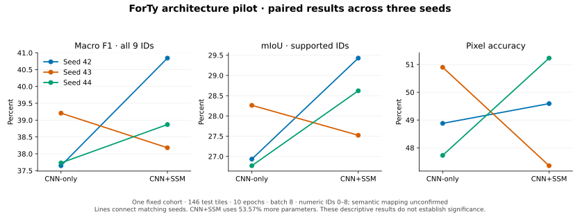

[Results index](../README.md) · [Research protocol](../../docs/research-pilot.md) · [Application brief](../../docs/application-brief.md)

# Three-seed ForTy architecture pilot on Tesla T4

The CNN + Mamba-inspired selective state-space model achieved a small average
improvement over CNN-only on this fixed, reduced-data cohort. Macro F1 rose
from **38.19 ± 0.88% to 39.30 ± 1.38%**, with a paired difference of
**+1.10 ± 2.11 percentage points**. Two seeds improved and one regressed.
The SSM model has **53.6% more parameters** and higher recorded training-process
wall time. These results do not establish a stable or capacity-matched
architecture advantage.



Each line joins the two models for one seed. These are three model-seed
replications on one shared test cohort, not independent geographic samples.
The [PNG](paired-seed-results.png) is available for export.

## Protocol and execution

The study completed in Colab on 2026-10-29. All six configurations differ
only in output directory, model variant and model seed.

| Setting | Retained value |
|---|---|
| Source | `7f55b2c30c830693873e1fe1628c8e52208ed57d`; all 13 recorded module hashes match |
| Runtime | Tesla T4; TensorFlow 2.21.0; Keras 3.13.2; Python 3.13.16; NumPy 2.1.3 |
| Data | Official `gs://forest_typology/forty_v1/1.0.0` source recorded in staging receipts |
| Cohort | 8 training / 4 validation / 8 test shards of each original 1,024-shard namespace |
| Selection | Fixed seed 2026; identical membership across all runs and epochs |
| Model seeds | 42, 43, 44 |
| Training | 10 epochs, batch 8, mixed float16; 1,195 examples and 150 batches per epoch |
| Evaluation | Float32; same 146 test tiles of 128 × 128, totaling 2,392,064 pixels |
| Selection rule | First maximum validation macro F1 across all nine numeric IDs |
| Checkpoints | SSM seed 42 selected epoch 9; all other runs selected epoch 10 |
| Shared objective | ComboLoss, weights, smoothing, AdamW, schedule, clipping and augmentation protocol |

Training order was SSM42, CNN42, CNN43, SSM43, SSM44, CNN44. All training
finished before the first model test evaluation. The ledger contains 16
completed stages: three preflights, six training runs, six evaluations and one
comparison, with one attempt per stage. The real-data run did not exercise
interrupted-run recovery; a separate synthetic CPU integration verified that
behavior.

CNN-only replaces optical temporal aggregation with a mean and removes both
SSM blocks, retaining fusion, CNN stages and local SASF. The ablation changes
capacity and temporal-order handling together; it does not isolate recurrence.
Training example/epoch budgets match. Applied optimizer updates differ
slightly because of mixed-precision loss scaling: each CNN-only run applied
1,499 of 1,500 batches; SSM applied 1,500, 1,500 and 1,499 respectively.
Four skipped updates are retained in the epoch histories.

Validation membership consists of four leading shards, test membership of
eight leading shards, and training membership of the sampled shard indices
243, 654, 210, 457, 861, 1005, 903 and 491. The validation example count is not
recorded. Filenames and receipts do not independently prove geographic
separation or representativeness.

## Numeric-ID results

| Metric | CNN-only | CNN+SSM | Paired SSM minus CNN |
|---|---:|---:|---:|
| Macro F1, all nine IDs | 38.19 ± 0.88% | 39.30 ± 1.38% | +1.10 ± 2.11 pp |
| Mean IoU, IDs with true/predicted support | 27.32 ± 0.82% | 28.52 ± 0.96% | +1.20 ± 1.71 pp |
| Pixel accuracy | 49.17 ± 1.61% | 49.39 ± 1.94% | +0.22 ± 3.55 pp |

Values are means ± sample standard deviations across three seeds. Differences
are in percentage points (`pp`), computed within each seed before aggregation.
These descriptive statistics do not establish significance or a reliable
population-level effect.

| Seed | CNN-only Macro F1 | CNN+SSM Macro F1 | F1 difference | IoU difference |
|---|---:|---:|---:|---:|
| 42 | 37.6462% | 40.8409% | +3.1947 pp | +2.4948 pp |
| 43 | 39.2071% | 38.1793% | −1.0277 pp | −0.7393 pp |
| 44 | 37.7304% | 38.8693% | +1.1389 pp | +1.8510 pp |

The primary report uses IDs 0–8, no ignored ID and no semantic forest-group
metrics. Macro F1 includes all nine IDs, assigning absent IDs F1 zero. IoU
averages IDs with true or predicted support; every ID has true support in this
pilot, so all nine contribute. The publisher's
[class mapping and Unknown protocol](https://github.com/google-deepmind/forest_typology/issues/2)
remain unresolved. Class names in legacy raw files retain the project's
earlier convention; they are not validated semantic labels for these results.

## Capacity and recorded process time

| Quantity | CNN-only | CNN+SSM |
|---|---:|---:|
| Parameters | 5,035,392 | 7,732,800 |
| Training-process wall time | 339.42 ± 37.95 s | 785.15 ± 24.44 s |
| Test-process wall time | 17.85 ± 3.45 s | 23.65 ± 4.70 s |

SSM adds 2,697,408 parameters, or 53.57%. Its mean training-process wall time
was 2.31× the CNN-only mean. Times cover one sequential session and include
startup, validation or evaluation, weight loading/saving and other process
work. They are not isolated kernel timings or steady inference throughput.
This archive contains no profiler traces or GPU-memory benchmark.

The separate **4.80×** result is T4 synthetic inference compute throughput at
batch eight versus batch one, using repeated inputs and excluding file IO.
It is neither this architecture's accuracy gain nor a measured production
speedup; see the [batch study](../batch_study_t4_20261028/README.md).

## Observed failure and uneven class effects

Numeric **ID 7** has 9,770 true test pixels (0.4084% of the cohort) but zero
predicted pixels in every run, giving F1 zero for both models at every seed.
The modest aggregate gain does not resolve this coverage failure.

Average per-ID F1 improves for IDs 1, 5 and 6, and decreases for IDs 0, 2, 3,
4 and 8. ID 5 is particularly variable: SSM F1 is 28.08%, 16.41% and 0.58%
across the three seeds. The [class CSV](class-metrics.csv) retains all supports
and seed values. These observations are exploratory diagnostics on the test
cohort. Any follow-up tuned to them needs a new held-out assessment.

## Evidence and verification boundary

The [original uploaded metadata ZIP](metadata.zip) is preserved byte-for-byte:

```text
SHA-256 ba644a9633e3af063dd083bf513d0b38319f9084d755ee0aa2dee9fd337bd3ba
111,422 bytes; 96 files; 408,174 uncompressed bytes
```

- All 95 files listed by the export manifest match their recorded sizes and
  SHA-256 hashes. The remaining file is that manifest itself.
- All six confusion matrices independently reproduce the primary metrics,
  per-ID supports, per-seed differences, means and sample standard deviations.
- All 16 stage receipts match the execution ledger. Their included output
  metadata, source/module identities and selected-data receipts are consistent.
- The retention manifest references 86 included metadata files and 12 excluded
  H5 paths. Recorded retention is six best and six last files, totaling
  308,911,968 bytes. Five best files equal their respective last files, so the
  twelve paths represent seven unique recorded weight hashes.
- Actual H5 weights, source TFRecords and source arrays are absent. Their
  recorded hashes and references were checked for consistency; their bytes
  and current Drive existence or durability were not independently verified.

Raw records are under [metadata/](metadata/), including the
[report](metadata/research_report.json),
[retention manifest](metadata/checkpoint_manifest.json),
[data receipt](metadata/selected_data.json) and
[execution ledger](metadata/research_state.json). They are immutable evidence;
derived artifacts are generated separately.

## Reproduce the offline audit and figure

With the repository's plotting dependencies installed, run from its root:

```bash
python results/architecture_pilot_t4_20261029/analyze.py
```

This checks the included evidence, reconstructs metrics without TensorFlow,
and writes [audit.json](audit.json),
[paired-seed-results.csv](paired-seed-results.csv),
[class-metrics.csv](class-metrics.csv) and the SVG/PNG figure. It does not
reload absent checkpoints, read GCS records or repeat training.
The CSV's `train_example_presentations` counts 1,195 examples over ten epochs
(11,950 presentations), not 11,950 unique training tiles.

A larger fixed-budget study, a capacity-matched CNN control, confirmation of
label semantics and independent geographic/full-test validation remain useful
next steps. New scientific settings require a new study ID and protocol.
